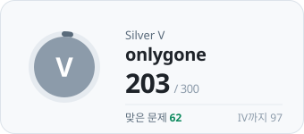
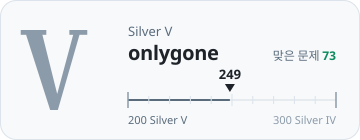

# BOJ 티어 배지

solved.ac 티어를 GitHub 프로필에 띄우는 배지예요.
GitHub Actions가 매일 아침 9시에 점수를 가져와서 배지를 새로 그려요. 서버는 필요 없어요.

 

## 쓰는 법

### 1. 이 레포를 내 계정으로 가져오기

Fork 하거나, 파일을 받아서 새 레포에 올리면 돼요.

### 2. 아이디 바꾸기

`.github/workflows/boj-badge.yml` 에서 이 줄만 내 백준 아이디로 바꿔요.

```yaml
BOJ_HANDLE: onlygone
```

### 3. solved.ac 앱 등록하기

solved.ac 최신 점수는 인증이 있어야 받을 수 있어요.

1. [solved.ac Backstage](https://backstage.solved.ac/developer/apps)에서 앱을 하나 만들어요.
2. 나온 **Client ID**와 **Client Secret**을 복사해요.
3. 이 레포의 **Settings → Secrets and variables → Actions → New repository secret**에서 두 개를 추가해요.
   - `SOLVED_AC_CLIENT_ID`
   - `SOLVED_AC_CLIENT_SECRET`

> 등록 안 해도 돌아가긴 하지만, 예전 API를 써서 점수가 늦게 반영될 수 있어요.

### 4. 한 번 직접 돌려보기

레포의 **Actions** 탭 → **BOJ badge** → **Run workflow** 를 눌러요.
1분쯤 지나서 `badges/` 폴더에 SVG 4개가 생기면 성공이에요.

> Fork 한 레포는 Actions가 꺼져 있을 수 있어요. Actions 탭에서 켜 주세요.

### 5. 프로필 README에 붙이기

프로필 레포(`내아이디/내아이디`)의 README.md에 아래를 붙여요.
`내아이디` 두 군데랑 `백준아이디`만 바꾸면 돼요.

메달형

```html
<a href="https://solved.ac/백준아이디">
  <picture>
    <source media="(prefers-color-scheme: dark)" srcset="https://raw.githubusercontent.com/내아이디/boj-badge/main/badges/a1-dark.svg">
    
  </picture>
</a>
```

로마 숫자형은 위에서 `a1` 을 `a3` 로, `width` 를 `360` 으로 바꾸면 돼요.

GitHub를 다크 모드로 보는 사람한테는 어두운 배지가 보여요.

## 이런 게 바뀌어요

- 티어 색 (브론즈부터 마스터까지)
- 레이팅, 다음 티어까지 남은 점수
- 진행 링, 눈금자
- 맞은 문제 수

점수가 안 바뀐 날은 커밋을 안 해요.

## 안 될 때

- **Actions가 push에서 실패해요**: Settings → Actions → General → Workflow permissions를 `Read and write` 로 바꿔요.
- **배지가 예전 숫자로 보여요**: GitHub가 이미지를 잠깐 캐시해요. 몇 분 뒤에 새로고침해 보세요.
- **한동안 자동 실행이 멈췄어요**: 레포에 60일 동안 활동이 없으면 GitHub가 예약 실행을 꺼요. Actions 탭에서 다시 켜면 돼요.

## 직접 돌려보기

```bash
export SOLVED_AC_CLIENT_ID=...         # 앱 Client ID
export SOLVED_AC_CLIENT_SECRET=...     # 앱 Client Secret
python generate.py --handle 백준아이디    # badges/ 에 배지 생성
python generate.py --gallery             # 모든 티어 미리보기 (gallery.html)
```

파이썬 3.10 이상이면 따로 설치할 건 없어요.
점수는 [solved.ac](https://solved.ac) 에서 가져와요. 글꼴은 [Pretendard](https://github.com/orioncactus/pretendard) (OFL)를 배지에 쓰는 글자만 잘라서 넣었어요.
