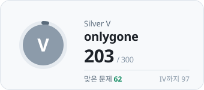
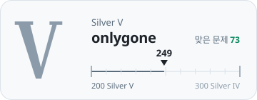

<!-- 프로필 README에 붙여 넣기: GitHub 라이트/다크 테마에 맞춰 자동으로 바뀜 -->

<!-- A1 메달형 -->
<a href="https://solved.ac/onlygone">
  <picture>
    <source media="(prefers-color-scheme: dark)" srcset="./badges/a1-dark.svg">
    
  </picture>
</a>

<!-- A3 로마 숫자형 -->
<a href="https://solved.ac/onlygone">
  <picture>
    <source media="(prefers-color-scheme: dark)" srcset="./badges/a3-dark.svg">
    
  </picture>
</a>
